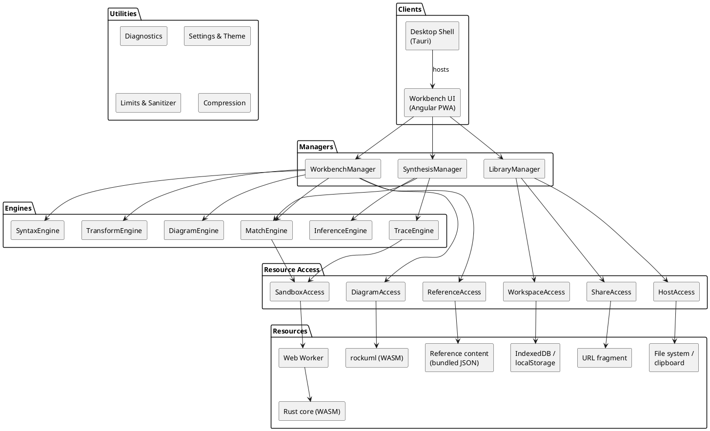

# Architecture

regex-bench follows the [IDesign method](https://www.idesign.net/): the system is decomposed along the
[[Architecture/Volatilities]], into layers with strict calling rules. This page is the **current** architecture
(iteration A2). How it got here, and how robust it is, is in [[Architecture/Residuality]].

## Layers and calling rules

The rules are those of IDesign, applied to a client-side app:

1. **Clients** call **Managers** only. A client never touches a resource or an engine directly.
2. **Managers** encapsulate the *sequence* of a use case. They call Engines and ResourceAccess. A manager never
   calls another manager synchronously; when one use case triggers another, it goes through a signal/event.
3. **Engines** encapsulate *activities* (business rules that vary). They may call ResourceAccess, never another
   engine and never a manager. Engines are pure functions where possible, which also makes them easy to run in a
   worker.
4. **ResourceAccess** exposes *atomic business verbs* (`saveSession`, `runInSandbox`, `renderDiagram`), never CRUD
   or the resource's own API. ResourceAccess never calls ResourceAccess.
5. **Utilities** can be used by any layer.
6. Only the shared contracts (`web/src/app/contracts/`) cross boundaries: `PatternSpec`, `Subject`,
   `MatchResult`, `RegexAst`, `Diagnostic`, `SessionState`.

## Components

### Clients

| Component | Responsibility | Volatility | Code |
| --- | --- | --- | --- |
| Workbench UI | Pattern editor, test text editor, result panes (match/replace/list/tests), explanation, diagram, reference. Signals drive all state. | V9 | `web/src/app/ui/` |
| Desktop Shell | Tauri host that loads the *same* build of the Workbench UI. Adds native file open and a stricter CSP. No business logic. | V6 | `desktop/src-tauri/` |

### Managers

| Component | Use cases | Encapsulates | Code |
| --- | --- | --- | --- |
| WorkbenchManager | US-01…06, 14, 16, 18 | The *evaluation workflow*: when the pattern, flags, flavor, mode or text change, it parses (SyntaxEngine), runs (MatchEngine), transforms (TransformEngine), and draws (DiagramEngine → DiagramAccess). It debounces, cancels stale runs and applies the size policy. | `web/src/app/managers/workbench.manager.ts` |
| SynthesisManager | US-11, 12, 13 | The *learning/verification workflows*: infer a pattern from data, run test suites, run the step debugger. | `web/src/app/managers/synthesis.manager.ts` |
| LibraryManager | US-08, 09, 10 | The *keep-and-share workflow*: autosave, history, named library, share links, import/export, file open. | `web/src/app/managers/library.manager.ts` |

### Engines

| Component | Activity | Volatility | Code |
| --- | --- | --- | --- |
| SyntaxEngine | Parses a pattern with a **dialect** into an AST with source spans; reports diagnostics; produces token classes for highlighting and the explanation tree. Each flavor is a dialect object (feature table), not a separate parser. | V1 | `web/src/app/engines/syntax/` |
| MatchEngine | Chooses an execution **backend** for the flavor (ECMAScript `RegExp`, Rust core) and returns `MatchResult`s. Always runs through SandboxAccess. | V2 | `web/src/app/engines/match/` |
| TransformEngine | Replacement templates (per-flavor syntax), list templates, code generation, flavor conversion. | V3 | `web/src/app/engines/transform/` |
| DiagramEngine | Turns an AST into a neutral diagram **notation** (PlantUML `@startregex` today). Does not render. | V4 | `web/src/app/engines/diagram/` |
| InferenceEngine | Synthesises a regex from example lines and marked spans. | V7 | `web/src/app/engines/inference/` |
| TraceEngine | A backtracking interpreter over the AST that records each step, counts steps and flags catastrophic patterns. | V2, V8 | `web/src/app/engines/trace/` |

### Resource access

| Component | Business verbs | Hides | Code |
| --- | --- | --- | --- |
| SandboxAccess | `execute(job, budget)` → result or `timeout` | Web Worker lifecycle, termination on budget overrun, WASM instantiation, fallback to the main thread when workers are unavailable | `web/src/app/access/sandbox.access.ts` |
| WorkspaceAccess | `saveSession`, `loadSession`, `recordHistory`, `listLibrary`, `saveToLibrary` | `localStorage` today, IndexedDB later, format versions and migration | `web/src/app/access/workspace.access.ts` |
| ShareAccess | `toLink(session)`, `fromLink(fragment)` | URL fragment format, compression, versioning, validation | `web/src/app/access/share.access.ts` |
| DiagramAccess | `render(notation)` → SVG | rockuml WASM, its loading and its API | `web/src/app/access/diagram.access.ts` |
| ReferenceAccess | `describe(token, flavor)`, `quickReference(flavor)` | Bundled reference content | `web/src/app/access/reference.access.ts` |
| HostAccess | `openTextFile`, `copy`, `isDesktop` | Browser File API vs Tauri, clipboard | `web/src/app/access/host.access.ts` |

### Resources

Web Worker, the Rust core compiled to `regex_core.wasm`, `rockuml.wasm`, browser storage, the URL fragment,
bundled reference content and the host's file system/clipboard. All of them are part of the build or the device:
the app has **no network resource**. The service worker caches the build for offline use.

### Utilities

Diagnostics (an in-memory log for the "about" panel; nothing is sent anywhere), Settings & Theme, Limits &
Sanitizer (input size limits, share-link validation, SVG-as-image rendering), Compression (`CompressionStream`
with a fallback).

## Cross-cutting decisions

- **Nothing leaves the device.** A strict Content-Security-Policy (`connect-src 'self'`, `default-src 'self'`) is
  set in `index.html` and in the Tauri config. Fonts are bundled from `@fontsource`. See [[Decisions/ADR-002-no-network]].
- **Every pattern runs in a sandbox with a budget.** User patterns are untrusted code from a performance point of
  view (ReDoS). See [[Decisions/ADR-003-sandboxed-execution]].
- **One parser, many dialects.** See [[Decisions/ADR-004-one-parser-many-dialects]].
- **Diagrams via rockuml.** See [[Decisions/ADR-005-rockuml-railroad]].
- **Rust core via plain C ABI**, no wasm-bindgen glue. See [[Decisions/ADR-006-rust-core-c-abi]].
