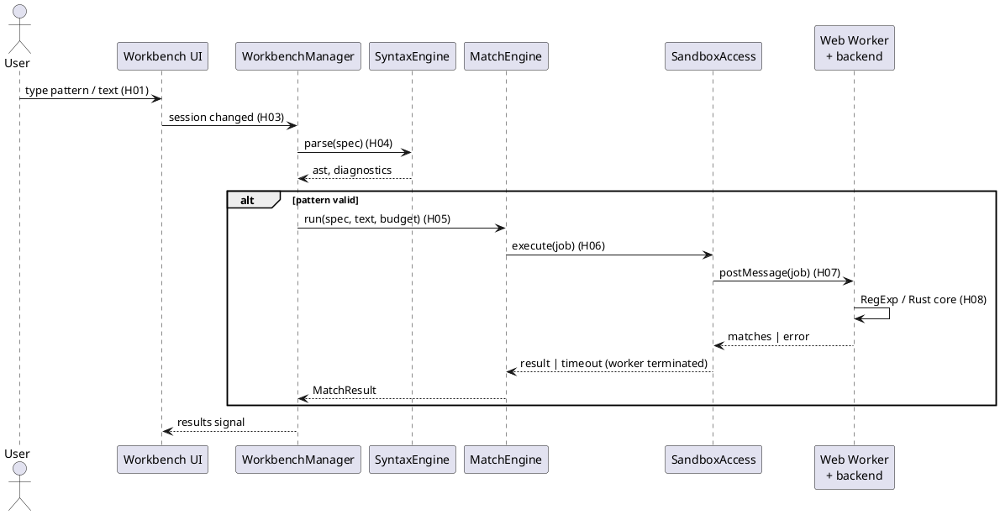
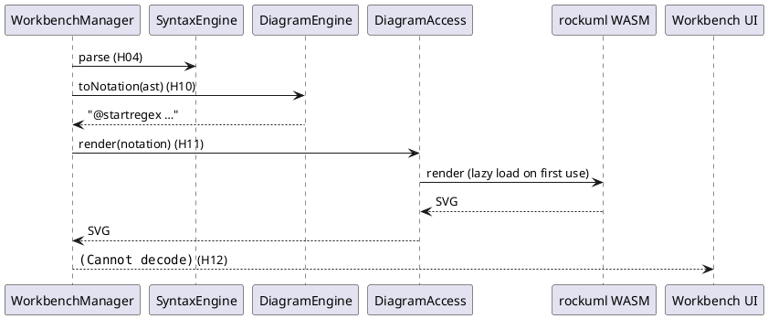
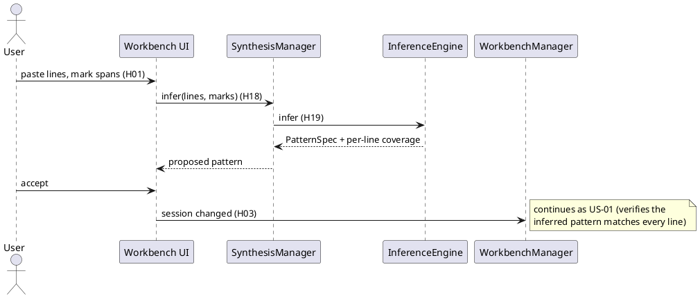

# Call chains

Each [[Architecture/User-stories|user story]] is a call chain through the components of [[Architecture]]. A
chain is a list of **hops**; each hop has an ID (`H01`…) so that the [[Architecture/STRIDE]] analysis can cover
every hop of every chain without repeating itself.

If a story cannot be drawn as a chain through the existing components, the architecture is missing something.
In iteration A0 several stories could not; see [[Architecture/Residuality]].

## Hop catalogue

| Hop | From → To | Crosses a trust boundary? | Carries |
| --- | --- | --- | --- |
| H01 | User → Workbench UI | **yes** (untrusted input) | pattern, flags, flavor, text, template, keystrokes, dropped files |
| H02 | URL fragment → Workbench UI → LibraryManager | **yes** (untrusted link) | encoded `SessionState` |
| H03 | Workbench UI → WorkbenchManager | no | `SessionState` signal |
| H04 | WorkbenchManager → SyntaxEngine | no | `PatternSpec` → `RegexAst` + `Diagnostic[]` |
| H05 | WorkbenchManager → MatchEngine | no | `PatternSpec`, text, budget |
| H06 | MatchEngine → SandboxAccess | no | `ExecJob` |
| H07 | SandboxAccess → Web Worker | **yes** (thread boundary, `postMessage`) | structured-clone `ExecJob` / `ExecResult` |
| H08 | Web Worker → backend (`RegExp` or Rust core WASM) | **yes** (WASM linear memory) | pattern bytes, text bytes → JSON |
| H09 | WorkbenchManager → TransformEngine | no | `MatchResult[]`, template → text |
| H10 | WorkbenchManager → DiagramEngine | no | `RegexAst` → notation |
| H11 | WorkbenchManager → DiagramAccess → rockuml WASM | **yes** (WASM) | notation → SVG |
| H12 | DiagramAccess result → Workbench UI | **yes** (generated markup into DOM) | SVG |
| H13 | WorkbenchManager → ReferenceAccess → bundled content | no | token kind → description |
| H14 | Workbench UI → LibraryManager | no | save/share/open intents |
| H15 | LibraryManager → WorkspaceAccess → browser storage | **yes** (persistent storage, shared origin) | `SessionState`, history, library |
| H16 | LibraryManager → ShareAccess → URL fragment / clipboard | **yes** (leaves the app) | encoded `SessionState` |
| H17 | LibraryManager → HostAccess → file system / clipboard | **yes** (OS) | file contents, clipboard text |
| H18 | Workbench UI → SynthesisManager | no | examples, marks, tests, debug intents |
| H19 | SynthesisManager → InferenceEngine | no | lines, marks → `PatternSpec` |
| H20 | SynthesisManager → TraceEngine → SandboxAccess → Worker | **yes** (thread boundary) | AST, text → `TraceStep[]` |
| H21 | SynthesisManager → MatchEngine (via H06–H08) | no | test cases |
| H22 | Static host / service worker → browser | **yes** (network, first load and updates only) | app build |
| H23 | Desktop Shell (Tauri) → Workbench UI | **yes** (native ↔ webview) | the bundled build, file-open IPC |
| H24 | CI (GitHub Actions) → GitHub Pages / Releases | **yes** (supply chain) | build artifacts |

## Chains per user story

Every chain implicitly starts with H22 (or H23 on the desktop), which delivers the app. That hop is listed
once, under US-10.

### US-01 Live match

H01 → H03 → H04 → H05 → H06 → H07 → H08

### US-02 Explain a pattern

H01 → H03 → H04 (AST + explanation tree) → H13 (token descriptions)

### US-03 Replace

H01 → H03 → H04 → H05 → H06 → H07 → H08 → H09 (template applied over matches)

### US-04 List

H01 → H03 → H04 → H05 → H06 → H07 → H08 → H09 (list template)

### US-05 Railroad diagram

H01 → H03 → H04 → H10 → H11 → H12

### US-06 Pick a flavor

H01 → H03 → H04 (dialect for the flavor) → H05 → H06 → H07 → H08 (backend for the flavor)

### US-07 Convert between flavors

H01 → H03 → H04 (parse with source dialect) → H09 (TransformEngine emits with target dialect, with warnings)

### US-08 Share by link

Create: H01 → H14 → H16 (fragment + clipboard)
Open: H02 → H14 → H03 → (US-01 chain)

### US-09 Library and history

H01 → H14 → H15

### US-10 Install and use offline

H22 (first load, service worker installs, caches the build) → later loads from cache with no network.
Desktop: H23 (the build is inside the binary).
Build: H24.

### US-11 Regex from data

H01 → H18 → H19 → H03 → (US-01 chain)

### US-12 Step debugger and catastrophic backtracking

H01 → H18 → H04 → H20 (TraceEngine in the sandbox, step budget)

### US-13 Unit tests

H01 → H18 → H21 → H06 → H07 → H08

### US-14 Quick reference

H01 → H03 → H13

### US-15 Code generation

H01 → H03 → H04 → H09 (code template per language)

### US-16 Large file

H01 or H17 (file open) → H03 → H04 → H05 → H06 → H07 → H08 (budget and result cap applied in H06/H07)

### US-17 Accessibility and themes

H01 → (any chain). This is a property of the Workbench UI client; it adds no hop.

### US-18 Named groups

H01 → H03 → H04 (names in AST) → H05…H08 (names in `MatchResult`) → H09 (`$<name>` in templates) → H10 (names in diagram)

## Chain × hop matrix

`●` = the chain uses the hop.

| | H01 | H02 | H03 | H04 | H05 | H06 | H07 | H08 | H09 | H10 | H11 | H12 | H13 | H14 | H15 | H16 | H17 | H18 | H19 | H20 | H21 | H22 | H23 | H24 |
|---|---|---|---|---|---|---|---|---|---|---|---|---|---|---|---|---|---|---|---|---|---|---|---|---|
| US-01 | ● | | ● | ● | ● | ● | ● | ● | | | | | | | | | | | | | | | | |
| US-02 | ● | | ● | ● | | | | | | | | | ● | | | | | | | | | | | |
| US-03 | ● | | ● | ● | ● | ● | ● | ● | ● | | | | | | | | | | | | | | | |
| US-04 | ● | | ● | ● | ● | ● | ● | ● | ● | | | | | | | | | | | | | | | |
| US-05 | ● | | ● | ● | | | | | | ● | ● | ● | | | | | | | | | | | | |
| US-06 | ● | | ● | ● | ● | ● | ● | ● | | | | | | | | | | | | | | | | |
| US-07 | ● | | ● | ● | | | | | ● | | | | | | | | | | | | | | | |
| US-08 | ● | ● | ● | | | | | | | | | | | ● | | ● | | | | | | | | |
| US-09 | ● | | | | | | | | | | | | | ● | ● | | | | | | | | | |
| US-10 | | | | | | | | | | | | | | | | | | | | | | ● | ● | ● |
| US-11 | ● | | ● | | | | | | | | | | | | | | | ● | ● | | | | | |
| US-12 | ● | | | ● | | | | | | | | | | | | | | ● | | ● | | | | |
| US-13 | ● | | | | | ● | ● | ● | | | | | | | | | | ● | | | ● | | | |
| US-14 | ● | | ● | | | | | | | | | | ● | | | | | | | | | | | |
| US-15 | ● | | ● | ● | | | | | ● | | | | | | | | | | | | | | | |
| US-16 | ● | | ● | ● | ● | ● | ● | ● | | | | | | | | | ● | | | | | | | |
| US-17 | ● | | | | | | | | | | | | | | | | | | | | | | | |
| US-18 | ● | | ● | ● | ● | ● | ● | ● | ● | ● | | | | | | | | | | | | | | |
